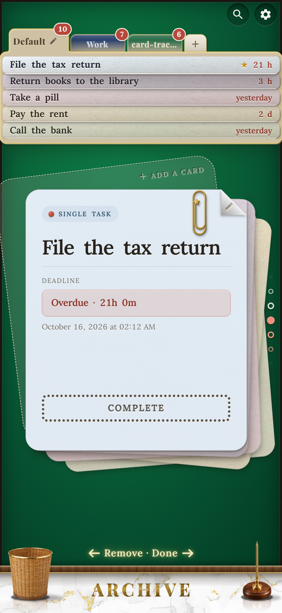
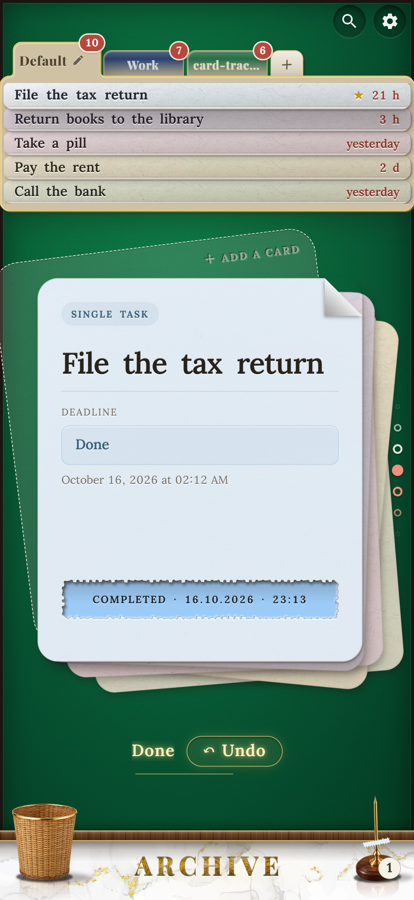
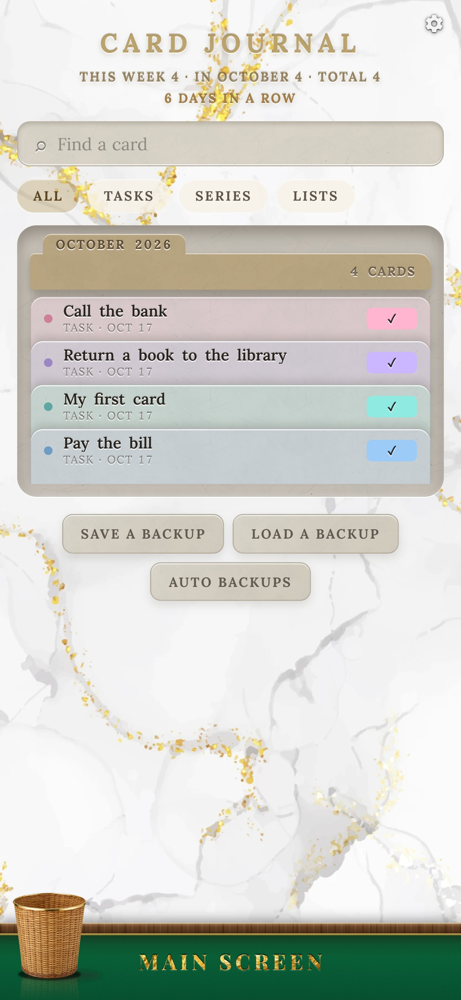
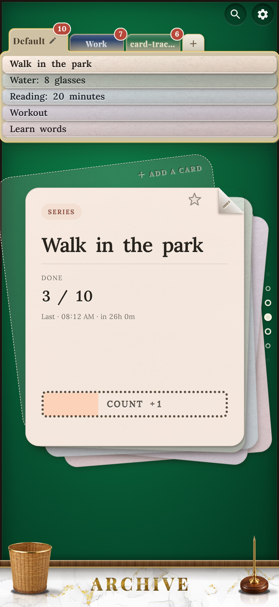
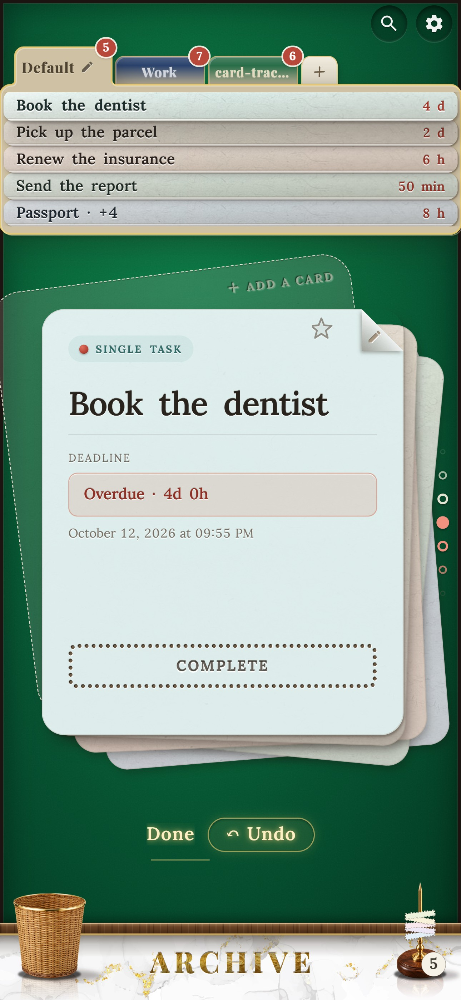

# Card Tracker

**A task tracker that looks and feels like things on a real desk.** Tasks are paper cards in a stack on green felt. When you finish one, its coupon tears off along the perforation, flies across the table and lands on a brass spike. Nothing evaporates: everything you have done stays in the Card Journal.

[](https://github.com/goshkomichael239-design/card-tracker/actions/workflows/ci.yml)

<p align="center">
  
  
  
</p>
<p align="center">
  
  
  
</p>

> **Try it:** web version <https://goshkomichael239-design.github.io/card-tracker/> · **Android:** APK on the [Releases](https://github.com/goshkomichael239-design/card-tracker/releases) page.

## Why

My name is Mikhail, I am a developer from Russia. I carried this idea for a year, and Claude Sonnet 5.5 helped me finish it.

In other trackers, when I mark a task as done, I don't see the result: the task just evaporates. Here everything stays in a beautiful archive, the *Card Journal*, and you can see all that you managed to do. And there is the small satisfaction of it: the coupon tears off, lands on the spike, the count grows.

In the most popular trackers (Todoist, TickTick, Microsoft To Do, Google Tasks, Any.do) completing a task is a tick and a struck-through line, and done tasks go to a collapsed list. Here it is a small event, and the result stays in sight.

## What sets it apart

- **A real desk, not a list.** Cards, decks with backs, a card file at the top, a “put off” stamp, a clip for pinned cards, a spike for what is done and a bin for what is thrown away. One light source, shadows to the lower right.
- **A tear you can feel.** The perforation is drawn with real holes; every card tears along its own, slightly different edge, and the slot matches the torn piece exactly. With sound and vibration.
- **Done things don't vanish.** The archive is a card file with month dividers, search, filters, series history and a streak of days in a row.
- **Quick entry in one line:** “call mom tomorrow at 9”, “push-ups 30 times”, “buy: bread, milk, eggs” (English and Russian).
- **Three kinds of cards:** a single task, a series (N repeats) and a list; deadlines, reminders, repeating cards (a tear-off calendar) and “put off” with a stamp.
- **Private by design.** No account and no server: your data lives on your device, and the app works offline.
- **Two languages** (English and Russian, by your phone's language or your choice) and several looks for the card file.

## Two versions

- **Android app** (APK from Releases): notifications for deadlines and reminders, vibration.
- **Web version** (GitHub Pages): installable as a PWA.

For now everything is stored locally on the device. Signing in with a Google account (to have the same tasks on several devices) is planned.

## Run it

You need Node.js (LTS).

```
npm install
npm run dev        # http://localhost:5173
npm run build      # the build goes to dist/
npm run preview    # look at the build
```

On a phone in the same network: `npm run dev -- --host` and open the computer's address. `?lang=en` or `?lang=ru` in the address shows a language for one visit.

### Build the Android APK

Install Node.js, Android Studio and JDK 21 once, then run `tools\build-apk.bat` (Windows): it builds `Card-Tracker.apk`. Details are in [ANDROID.md](ANDROID.md).

### Check

```
npm run lint
npm test           # logic tests: dates, repeats, quick entry, the coupon, backups, the dictionary
npm run build
```

The same checks run on GitHub for every commit.

## Built with

React 19, TypeScript, Vite, Tailwind CSS 4, Framer Motion, Zustand, IndexedDB, Capacitor (the Android shell, haptics and local notifications), Vitest.

## Assets and credits

- **Fonts:** Lora and Playfair Display, SIL Open Font License 1.1 (see `src/assets/fonts`).
- **Sounds:** Kenney, Luckius, OwlishMedia, Iochi Glaucus (CC0) and a few made for this project; the list is in [`src/assets/sounds/SOURCES.md`](src/assets/sounds/SOURCES.md).
- **Pictures** of the bin, the spike and the paper clip were drawn by the author with the help of neural networks and then edited.
- Everything else (felt, paper, perforation, shadows) is drawn with code (SVG, CSS).

## Roadmap

What is done, postponed, cancelled and ahead: [ROADMAP.md](ROADMAP.md).

## Support

The app is free for everyone. If you want to support the author, donations are accepted in USDT on the TON network, USDT only (address: `UQCubsh1Af5AKdZnENzZVszC37M7vXb_Eo0Pqy1EI1hT3evi`, also on the *About* screen of the app). In the future I do not rule out monetization: new features or other modes, for example a habit tracker.

## Privacy

Card Tracker has no account, no analytics and no server. Your cards are stored in your browser's database (or in the Android app's storage) and never leave the device unless you export a backup yourself.

## License

[GNU AGPL-3.0](LICENSE) © 2026 Mikhail. Free to use, study and change; if you distribute a modified version or run it as a network service, you must publish your source under the same licence. Third-party assets keep their own licences (see above).

Russian version: [README.ru.md](README.ru.md).
