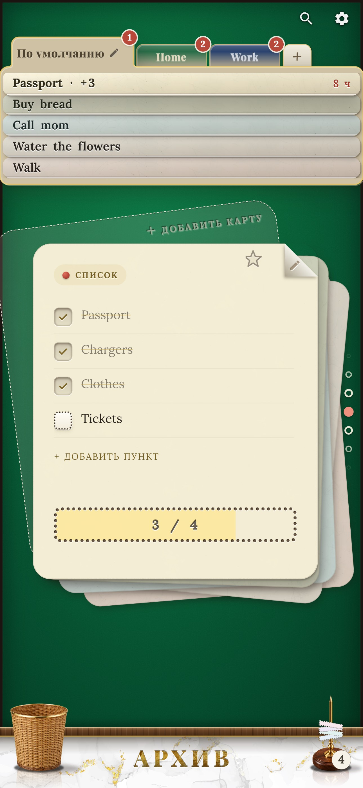

# Card Tracker

**Трекер задач, который выглядит и ведёт себя как вещи на настоящем столе.** Задачи это бумажные карточки в стопке на зелёном сукне. Когда дело сделано, купон отрывается по перфорации, летит через стол и ложится на латунный штырь. Ничего не испаряется: всё сделанное остаётся в «Журнале карточек».

[](https://github.com/goshkomichael239-design/card-tracker/actions/workflows/ci.yml)

<p align="center">
  
  
  
</p>

> **Попробовать:** веб-версия <https://goshkomichael239-design.github.io/card-tracker/> · **Android:** APK в разделе [Releases](https://github.com/goshkomichael239-design/card-tracker/releases).

## Зачем

Меня зовут Михаил, я разработчик из России. Я вынашивал эту идею год, а довести её до конца мне помог Claude Sonnet 5.5.

В других трекерах, когда я отмечаю дело сделанным, я не вижу результата: дела просто испаряются. Здесь всё остаётся в красивом архиве, «Журнале карточек», и видно всё, что ты успел. И ещё приятное чувство: купон оторвался, лёг на штырь, счётчик вырос.

В самых популярных трекерах (Todoist, TickTick, Microsoft To Do, Google Tasks, Any.do) это галочка и зачёркнутая строка, сделанное уходит в свёрнутый список. Здесь это маленькое событие, а результат остаётся на виду.

## Чем отличается

- **Настоящий стол, а не список.** Карточки, колоды с рубашками, картотека сверху, штамп «Отложено», скрепка для закреплённых, штырь для сделанного и корзина для выброшенного. Один источник света, тени вправо-вниз.
- **Отрыв, который чувствуется.** Перфорация нарисована настоящими отверстиями, у каждой карточки свой слегка отличающийся рваный край, а лунка точно совпадает с оторванным куском. Со звуком и вибрацией.
- **Сделанное не исчезает.** Архив-картотека с разделителями месяцев, поиском, фильтрами, историей серий и серией дней подряд.
- **Быстрая запись одной строкой:** «завтра в 9 позвонить маме», «отжаться 30 раз», «купить: хлеб, молоко, яйца» (по-русски и по-английски).
- **Три вида карточек:** одна задача, серия (N раз) и список; сроки, напоминания, повторяющиеся карточки (отрывной календарь) и «отложить» со штампом.
- **Приватно по замыслу.** Без аккаунта и сервера: данные на вашем устройстве, работает без сети.
- **Два языка** (по языку телефона или по выбору) и несколько видов картотеки.

## Две версии

- **Приложение для Android** (APK из Releases): уведомления о сроках и напоминаниях, вибрация.
- **Веб-версия** (GitHub Pages): можно установить как PWA.

Пока всё хранится только на устройстве. Вход через аккаунт Google (чтобы те же задачи были на нескольких устройствах) запланирован.

## Запуск

Нужен Node.js (LTS).

```
npm install
npm run dev        # http://localhost:5173
npm run build      # сборка в dist/
npm run preview    # посмотреть сборку
```

APK: поставить Node.js, Android Studio и JDK 21, запустить `tools\build-apk.bat`, подробности в [ANDROID.md](ANDROID.md). Проверка: `npm run lint`, `npm test`, `npm run build`.

## Из чего сделано

React 19, TypeScript, Vite, Tailwind CSS 4, Framer Motion, Zustand, IndexedDB, Capacitor (оболочка Android, вибрация, уведомления), Vitest.

## Ресурсы и благодарности

- **Шрифты:** Lora и Playfair Display, SIL Open Font License 1.1.
- **Звуки:** Kenney, Luckius, OwlishMedia, Iochi Glaucus (CC0) и несколько сделанных здесь; список в [`src/assets/sounds/SOURCES.md`](src/assets/sounds/SOURCES.md).
- **Картинки** корзины, штыря и скрепки нарисованы автором с помощью нейросетей и доработаны.

## Дорожная карта

[ROADMAP.md](ROADMAP.md): что сделано, отложено, отменено и что впереди.

## Поддержать

Приложение бесплатное для всех. Если хотите поддержать автора, можно отправить донат. Обратите внимание на монету: каждый адрес принимает только свою монету в сети TON, всё остальное, отправленное на него, может пропасть.

| Монета | Сеть | Адрес |
|---|---|---|
| GRAM (бывший Toncoin) | TON | `UQCd2PUDEvWKAbVLrcaE1VDU69wuxGy2WdM_f5jOZ0EhdjJK` |
| USDT (долларовый стейблкоин) | TON | `UQCubsh1Af5AKdZnENzZVszC37M7vXb_Eo0Pqy1EI1hT3evi` |

Те же адреса есть на экране «О программе», там адрес копируется нажатием.

В будущем я не отказываюсь от монетизации: новых функций или других режимов, например трекера привычек.

## Приватность

Нет аккаунта, аналитики и сервера. Карточки лежат в базе браузера (или в хранилище приложения Android) и не покидают устройство, пока вы сами не сохраните копию.

## Лицензия

[GNU AGPL-3.0](LICENSE) © 2026 Михаил. Можно свободно использовать, изучать и менять; если вы распространяете изменённую версию или запускаете её как сетевой сервис, нужно открыть свой код под той же лицензией. Сторонние ресурсы сохраняют свои лицензии (см. выше).

English version: [README.md](README.md).
